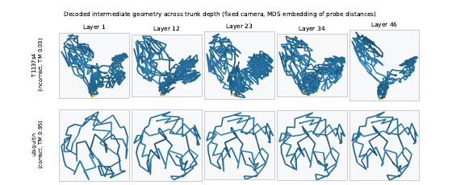
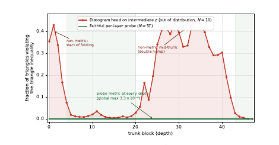

# A Faithful Per-Layer Geometric Readout of the ESMFold Trunk

William Klett 
Princeton University 
wk2617@princeton.edu

## Abstract

Single-pass structure predictors such as ESMFold are accurate, and work into their mechanistic interpretability is seldom. Prior work centers what information the models process, and where in the model that happens. Only briefly has the question of how the model operates, what interpretable procedure it performs on such information, been explored. This work addresses just that question, introducing a *faithful per-layer geometric readout*: a distogram autoencoder trained per block to reconstruct that block's pair representation, giving insight into the changing geometric representations through the model. We then define a rigorous test of the probe's faithfulness, arguing that the metricity of the probe's output distograms is sufficient to show that the distograms represent *the actual geometric content of a layer*.

## 1 The problem: reading the trunk's intermediate beliefs

Single-pass structure predictors such as ESMFold (Lin et al., 2023) are accurate but mechanistically opaque. The trunk iteratively refines a pair representation $z \in \mathbb{R}^{L \times L \times d}$ over 48 blocks; reading its intermediate states faithfully would reveal *how* a structure assembles. Interpretability of these models splits into two questions. The first — *what the model is thinking about* — asks what content is *decodable* from a representation, and is the province of linear probes and sparse autoencoders (Simon & Zou, 2025; Parsan et al., 2025; Gujral et al., 2025; Adams et al., 2025; Lu et al., 2026); these establish that geometric content is linearly present in the trunk and sharpens with depth, but not, by construction, what the model's belief at a given layer *is*. The second — *what those thoughts are* — asks for the evolving internal belief itself. Two existing routes to it both fail.

**Problem 1: the head is out-of-distribution mid-trunk.** The simplest route is the folding analogue of the *logit lens* (nostalgebraist, 2020): read an intermediate state by applying the model's own output head to it. As in language models, the head is biased because intermediate layers may use a basis it does not expect. Li et al. (2026) make exactly this move, applying OpenFold's (Ahdritz et al., 2024) distogram head to intermediate Evoformer layers, and the same pathology appears: the implied distance maps violate the triangle inequality across a wide mid-trunk band (an “M”-shaped violation curve). This contradicts the decodability result above — we cannot jointly hold that intermediate readouts are non-metric and that geometry is linearly present in $z$ — and the resolution is that the non-metricity belongs to the *instrument* (the OOD head), not to $z$. The language-model remedy, the *tuned lens* (Belrose et al., 2023), trains a per-layer translator for decoding *coherence*; our probe is instead constrained for content-*faithfulness*, validated through an invariant it was never trained to satisfy.

**Problem 2: native-supervised readouts measure the wrong thing.** The alternative is to train a structure module per block against true structure (Jumper et al., 2021). This avoids the OOD problem but measures *downstream sufficiency* — how recoverable the answer is from layer $t$ — not what $t$ represents. The consequence is direct: a confidently *wrong* intermediate belief has definite content — a specific incorrect geometry — but a ground-truth decoder reports only low decodability and misses that a coherent wrong belief is present.

## 2 Training a faithful readout

We define the model's geometric belief at layer $t$ as the distance distribution that best *reconstructs* $z_t$. Two design challenges follow, in tension: the probe must reconstruct $z_t$, yet its bottleneck must encode *geometric* information rather than a generic code.

**Probe construction.** For each layer we train a per-pair distogram autoencoder (pair dimension 128, 64 distance bins, hidden width 256): $z[i,j] \rightarrow$ bottleneck distogram $\rightarrow$ reconstruct $z[i,j]$. The loss has two terms reflecting the dual constraints of faithfulness: a per-pair reconstruction MSE, and a KL term anchoring the distribution at layer $n$ to the one at $n+1$. We train sequentially from the last hidden layer back to the first, so each layer's belief is free to drift further from the output anchor. The anchor is applied *only* at the in-distribution final layer, where ESMFold's own head is valid; no intermediate layer ever sees native structure.

**Figure 1: The readout, rendered: decoded intermediate geometry, fixed camera.** MDS embedding of the probe-read expected distances at five layers, one Kabsch-aligned camera throughout. *Top:* T1137s4, folded incorrectly (TM 0.03) — large but coherent global reconfigurations. *Bottom:* ubiquitin, folded correctly (TM 0.95) — a stable globular shape refined locally. Each panel is one block's geometric belief.

**Figure 2: Triangle-inequality violation vs. depth: out-of-distribution head vs. faithful probe.** The native distogram head on intermediate $z$ ($N=10$) gives an “M”-shaped curve, metric only where its input resembles its training distribution; the trained per-layer probe ($N=57$) is metric at every depth (global maximum violation $3.3 \times 10^{-4}$). Same trunk and representations — only the readout differs.

**Chaining is licensed by small per-block updates.** Anchoring to the adjacent layer relies on geometric content being iteratively refined rather than drastically reconfigured, which we verify directly: the per-block relative update $\lVert z_{t+1} - z_t \rVert / \lVert z_t \rVert$ (Frobenius norm, all 57 proteins) never exceeds 0.75, carries no spike, and settles to $\approx 0.21$. Adjacent layers are close everywhere, so each backward link is a small extrapolation, licensing the chained trajectory.

## 3 Metricity verification: the readout is faithful

Reconstruction forces each probe to encode whatever distinguishes its layer, and geometric versus non-geometric content predict oppositely. Non-geometric content forced through a per-pair distance code yields inconsistent distances that, since the probes are chained, accumulate into rising stress and triangle violations toward early layers; genuinely geometric content instead stays mutually metric-consistent with no enforcement, flat at zero across all depths.

**Why this cannot be inherited from the anchor.** The obvious objection is that the KL consistency term, which ultimately chains back into a metric anchor, forces each layer to produce a metric output. However, we ask you to consider that the residual between layers is determined by the reconstruction loss term alone. That is, if KL divergence were the only loss term, probe outputs would be the same across all layers; the reconstruction requirement forces each probe to be faithful to its own layer, encoding as much of the layers information as possible. It then only happens to be—it is not entailed that—the difference between layers adds information which maintains the metricity of the probe outputs.

**Empirical result.** Across $n = 57$ benchmark proteins the probe's distance maps are essentially perfectly metric. The global maximum triangle-inequality violation over all proteins and all 46 depths is $3.3 \times 10^{-4}$, and most proteins are exactly zero, and MDS embedding stress is low and flat (per-protein mean 4.9–11.1 Å, with no growth toward early layers) regardless of final fold quality. The methodological centerpiece is the direct head-vs-probe contrast: ESMFold's native distogram head applied to intermediate representations is sharply non-metric across two bands: the start of folding (blocks 0–3, up to 43% of sampled triples violating the inequality) and a broad double-humped mid-trunk region (blocks 21–41, peaking near 45%), while the faithful probe is metric at every depth.

## References

E. Adams, L. Bai, M. Lee, Y. Yu, and M. AlQuraishi. From mechanistic interpretability to mechanistic biology: Training, evaluating, and interpreting sparse autoencoders on protein language models. *bioRxiv*, 2025.02.06.636901, 2025.

G. Ahdritz et al. OpenFold: Retraining AlphaFold2 yields new insights into its learning mechanisms and capacity for generalization. *Nature Methods*, 21:1514–1524, 2024.

N. Belrose, Z. Furman, L. Smith, et al. Eliciting latent predictions from transformers with the tuned lens. *arXiv:2303.08112*, 2023.

O. Gujral, M. Bafna, E. Alm, and B. Berger. Sparse autoencoders uncover biologically interpretable features in protein language model representations. *PNAS*, 122(34):e2506316122, 2025.

J. Jumper, R. Evans, A. Pritzel, et al. Highly accurate protein structure prediction with AlphaFold. *Nature*, 596:583–589, 2021.

S. Li, Z. Mu, and C. Yan. Dissecting the black box of AlphaFold in protein–protein complex assembly. *bioRxiv*, 2026.04.03.716280, 2026.

Z. Lin, H. Akin, R. Rao, B. Hie, et al. Evolutionary-scale prediction of atomic-level protein structure with a language model. *Science*, 379(6637):1123–1130, 2023.

K. Lu, J. Brinkmann, S. Huber, et al. Mechanisms of AI protein folding in ESMFold. *arXiv:2602.06020*; ICLR 2026 GEM Bio Workshop, 2026.

nostalgebraist. Interpreting GPT: the logit lens. LessWrong/Alignment Forum, 2020.

N. Parsan, D. J. Yang, and J. J. Yang. Towards interpretable protein structure prediction with sparse autoencoders. *arXiv:2503.08764*; ICLR 2025 GEM workshop, 2025.

E. Simon and J. Zou. InterPLM: Discovering interpretable features in protein language models via sparse autoencoders. *Nature Methods*, 22:2107–2117, 2025.
